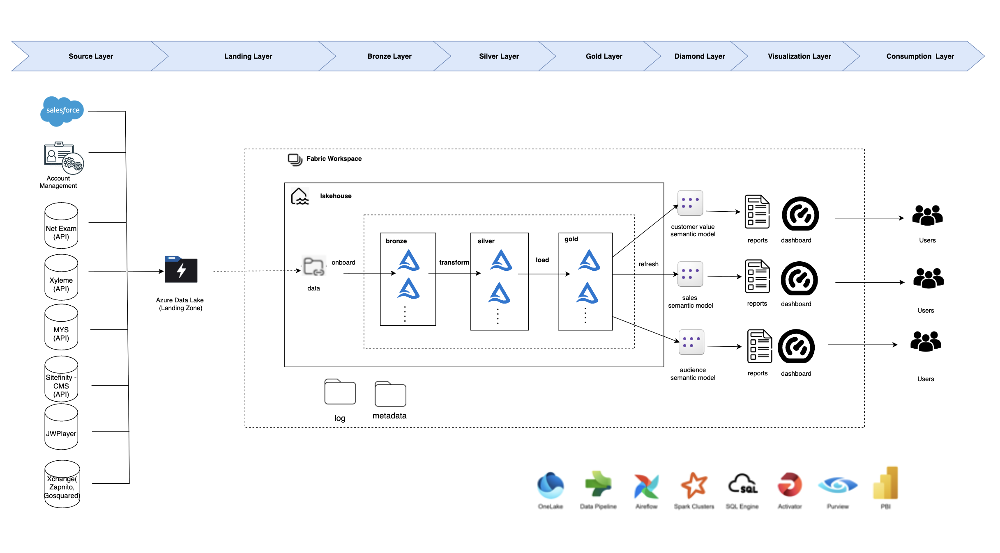
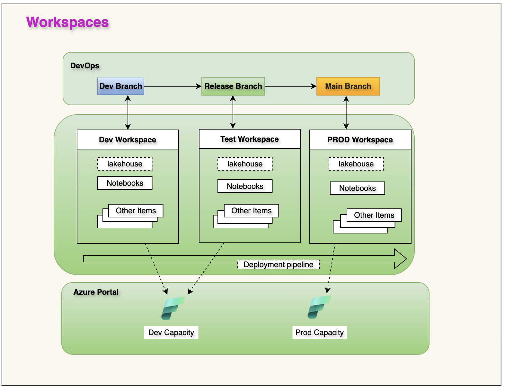

# Avixa – Enterprise Data Modernization & Analytics Platform

**Role:** Data Architect / Lead Engineer  
**Domain:** Audio-Visual Industry Association (Non-Profit / Membership)  
**Tech Stack:** Microsoft Fabric, Azure Data Lake (OneLake), Power BI, Apache Spark, SQL, Salesforce, Sage Intacct, Pardot

## 🎯 Project Overview
AVIXA, the global association for the audio-visual industry, faced challenges with fragmented data silos across their CRM (Salesforce), ERP (Sage Intacct), and marketing automation (Pardot) systems. As the **Data Architect / Lead Engineer**, I led the "Fabric POV" initiative to modernize their data estate. 

The goal was to build a unified analytics platform that could accurately measure **Customer Value**, **Sales Performance** (from pipeline to recognized revenue), and **Audience Engagement** (from prospect to member).

## 🏗️ Architecture & Implementation
I architected a **Microsoft Fabric Data Lakehouse** utilizing a **Medallion Architecture** (Bronze, Silver, Gold) to ensure data quality, scalability, and clear separation of concerns.

*Figure 1: End-to-end data flow from Source Systems through the Medallion Architecture to Power BI Consumption.*

- **Data Ingestion (Bronze):** Built automated pipelines to ingest raw data from Salesforce (Accounts, Opportunities), Sage Intacct (Financials), and Pardot (Audience/Leads) into OneLake.
- **Transformation (Silver):** Implemented data cleansing, deduplication, and standardization logic using Spark notebooks. This included creating a unified "Audience" dataset merging Leads, Contacts, and Pardot prospects.
- **Modeling (Gold):** Designed domain-specific semantic models for three core business areas:
    1.  **Value of Customer:** Tracking growth across segments (Broadcast AV, IT, Education) and monitoring Tier 1A account movement.
    2.  **Sales Performance:** Creating an end-to-end view from Pipeline → Contracted → Recognized Revenue, ensuring alignment between CRM and ERP within a **±2% tolerance**.
    3.  **Audience Engagement:** Profiling digital and event engagement to measure conversion rates from audience to paying customer.

## 🚀 DevOps & Governance
To ensure enterprise-grade reliability, I established a robust CI/CD and governance framework mapped directly to Microsoft Fabric capacities.

*Figure 2: Multi-workspace DevOps strategy mapping Git branches to Fabric capacities.*

- **3-Tier Workspace Strategy:** Mapped Git branches (Dev → Release → Main) to dedicated Dev, Test, and PROD workspaces.
- **CI/CD Pipelines:** Implemented automated deployment pipelines to promote notebooks, data pipelines, and lakehouse artifacts from Dev Capacity to Prod Capacity securely.
- **Data Governance:** Defined strict "Source of Truth" rules: Salesforce for CRM data, Sage Intacct for Revenue, and Pardot for Engagement metrics.

## 📊 Business Impact
- **Unified Reporting:** Delivered three executive-level Power BI dashboards replacing manual, fragmented Excel-based reporting.
- **Forecast Accuracy:** Improved revenue forecasting by aligning Salesforce pipeline data with Sage Intacct recognized revenue.
- **Strategic Insight:** Enabled leadership to track "Treat As" tier overrides and segment-specific growth (e.g., emerging markets vs. legacy Broadcast AV).