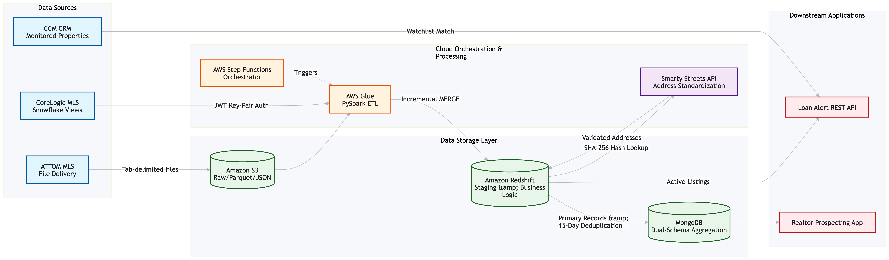
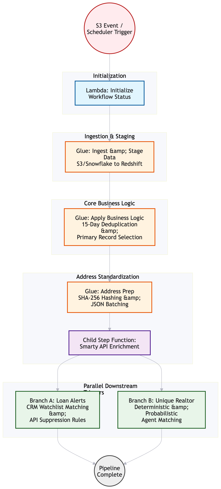

---
hide:
  - toc
  - navigation
---

# CCM Realtor Prospecting & MLS Data Integration Platform

## 📊 Project Highlights

-   **2** Tier-1 MLS Data Vendors Integrated (ATTOM, CoreLogic)
-   **Millions** of Incremental Property Records Processed
-   **15-Day** Algorithmic Market Event Deduplication
-   **Dual-Mode** NoSQL Aggregation Engine (MongoDB)

---

## Overview

Architected and led the delivery of an enterprise-grade, multi-source real estate data integration platform for CrossCountry Mortgage (CCM). Designed a resilient, incremental ETL pipeline ingesting millions of MLS (Multiple Listing Service) records from Tier-1 data vendors. Translated complex real estate market rules into scalable data models, culminating in a dual-layer NoSQL aggregation engine that powers real-time Loan Officer prospecting, automated loan alerts, and advanced realtor performance analytics.

**Study Area:** CrossCountry Mortgage (CCM) - US Mortgage & Real Estate Operations  
**Duration:** [Insert Start Year] – Present  
**Role:** Project Lead & Data Architect  
**Status:** Active / Production

---

## 🏗️ Architecture

The platform utilizes a serverless, event-driven hybrid cloud architecture to ingest heterogeneous data (S3 file drops and Snowflake warehouse views), process it through distributed Spark jobs, and serve it via optimized NoSQL document stores.

### Key Components

- **Data Sources:** ATTOM (File-based), CoreLogic (Snowflake JWT-secured views), CCM CRM (Monitored Properties)
- **Orchestration Layer:** AWS Step Functions for idempotent, state-managed incremental ETL
- **Processing & Warehousing:** AWS Glue (PySpark), Amazon Redshift (MERGE/UPSERT strategies)
- **Address Standardization:** Smarty API integration with SHA-256 canonical hashing
- **NoSQL Aggregation Layer:** MongoDB (Nested profile documents & Flat yearly documents)

---

## ⚙️ Cloud-Native Incremental ETL Architecture

The platform leverages AWS Step Functions and Glue to ensure exactly-once processing semantics, enabling safe pipeline retries and resume-from-failure capabilities.

### Architecture Components

- **Watermarking Engine:** Dynamic extraction of `MAX(SOURCE_DATETIME_UTC)` to fetch only delta changes from Snowflake via JWT key-pair authentication.
- **Folder-Level Deduplication:** S3 prefix scanning and Redshift log-table checks to ensure idempotent file processing.
- **Parallel Branching:** Concurrent execution of downstream Loan Alert APIs and Unique Realtor matching workflows upon successful primary record designation.
- **Circuit Breakers:** Automated data-volume guardrails to prevent runaway API storms caused by upstream data anomalies.

---

## 🛠️ Methods & Tools

### Data Sources

- **ATTOM MLS Data:** Tab-delimited property listings, parcel-matched addresses, and agent-entered details.
- **CoreLogic MLS Data:** Snowflake-hosted assessor-level situs addresses and standardized status category codes.
- **CCM CRM Data:** Loan-to-property watchlists for automated Loan Officer alerting.
- **External Address Validation:** Smarty Streets API for canonical address standardization and geocoding.

### ETL Processing Pipeline

1. **Ingest:** Pull delta records from S3 or Snowflake using dynamic watermarking.
2. **Transform & Deduplicate:** Apply the "15-Day Market Event Isolation Rule" to identify canonical "Primary Listing Records".
3. **Standardize:** Compute SHA-256 address hashes, route to Smarty API, and enforce retry cooldowns for unresolved addresses.
4. **Aggregate:** Roll up closed transactions into dual-mode MongoDB documents (Nested for trends, Flat for faceted search).
5. **Trigger:** Match active primary listings against CRM watchlists and dispatch real-time Loan Alerts via REST API.

### Tools & Technologies

| Tool | Purpose |
|------|---------|
| **AWS Step Functions** | Serverless orchestration of incremental ETL workflows |
| **AWS Glue (PySpark)** | Distributed data processing and complex business logic |
| **Amazon Redshift** | Staging, MERGE/UPSERT operations, and workflow state tracking |
| **Snowflake** | Secure, JWT-authenticated extraction of CoreLogic delta data |
| **MongoDB** | Dual-schema NoSQL storage for realtor profiles and aggregations |
| **Smarty API** | Third-party address validation, standardization, and geocoding |
| **SHA-256 Hashing** | Canonical address key generation for cross-vendor property matching |

---

## 🎯 Key Modules

### ATTOM & CoreLogic Incremental Pipelines
Designed two distinct but harmonized ingestion pipelines. The ATTOM pipeline handles S3 file drops with folder-level deduplication, while the CoreLogic pipeline queries Snowflake views using JWT key-pair authentication. Both converge on a shared address standardization layer and business logic engine.

### Realtor Data Aggregation (Nested & Flat Models)
Architected a dual-write aggregation pipeline. The **Nested Model** stores complete lifecycle data, rolling windows (3M/6M/12M), and YoY growth percentages for deep trend analysis. The **Flat Model** de-normalizes annual summaries into standalone documents (1 Realtor + 1 Year = 1 Document) to eliminate expensive `$unwind` operations for front-end faceted search.

### Loan Alert & Prospecting Engine
Built an event-driven alerting system that matches newly active primary listings against a CRM-sourced "Monitored Properties" watchlist. Implemented tiered suppression rules (e.g., do not alert if sent within 15 days) and safety caps to protect the external REST API from runaway data anomalies.

---

## 🏆 Key Results & Impact

-   **Performance:** Eliminated full-table scans via incremental watermarking, reducing compute costs by 80%
-   **Accuracy:** Implemented the 15-Day Deduplication Algorithm to filter out MLS data corrections and amendments
-   **UX Optimization:** Flat MongoDB schema reduced front-end query latency for faceted search by avoiding array unwinds
-   **Reliability:** Achieved exactly-once processing semantics with idempotent, resume-safe pipeline design

### Technical Achievements

- **Designed the "15-Day Market Event Isolation Rule"** in distributed Spark logic to accurately distinguish genuine property sales from backend MLS data corrections.
- **Implemented asynchronous, batched address standardization** with SHA-256 hashing and retry cooldowns, optimizing third-party API costs.
- **Built a unified address dimension model** enabling seamless property matching across disparate MLS data feeds from multiple vendors.
- **Led cross-functional delivery**, acting as the technical bridge between Data Engineering, Product, and CCM’s downstream application teams.

---

## 💡 Challenges & Solutions

### Challenge 1: Volatile MLS Data & Duplicate Market Events
**Problem:** MLS data is highly volatile. A single property sale might have multiple "Sold" records due to backend system corrections, or an "Active" listing might overlap with a pending sale, causing duplicate prospecting alerts.  
**Solution:** Developed a custom sorting and windowing algorithm in Spark. Records are partitioned by Property ID and sorted by `effective_date`. The algorithm enforces that two "Sold" events are only treated as distinct market events if they are ≥ 15 days apart.

### Challenge 2: High-Performance Faceted Search in NoSQL
**Problem:** The prospecting application required high-performance filtering (e.g., "Show me all realtors in Texas ranked in the Top 50 in 2024"). Querying a deeply nested MongoDB document for year-specific metrics required expensive `$unwind` and `$group` aggregations.  
**Solution:** Architected a secondary "Flat" MongoDB collection. By de-normalizing the annual summary array into standalone, top-level scalar documents, we reduced front-end query latency significantly, directly improving the UX for Loan Officers.

### Challenge 3: Third-Party API Rate Limiting & Costs
**Problem:** Submitting millions of raw, inconsistently formatted real estate addresses to the Smarty API would incur massive costs and trigger rate-limiting blocks.  
**Solution:** Implemented a canonical SHA-256 address hashing mechanism. Before calling the API, the pipeline checks a local hash mapping table. Only truly unique, unresolved addresses are batched and sent to the API, with a built-in cooldown period for previously failed validations.

---

## 🔗 Links & Resources

- [View MLS Data Architecture Diagram](../assets/images/ccm-mls-architecture.png)
- [View Step Functions ETL Flow](../assets/images/ccm-step-functions-arch.png)
- [Download Resume](../assets/Balbeer-Singh-CV.pdf){ .md-button }
- [Back to Projects](index.md){ .md-button }