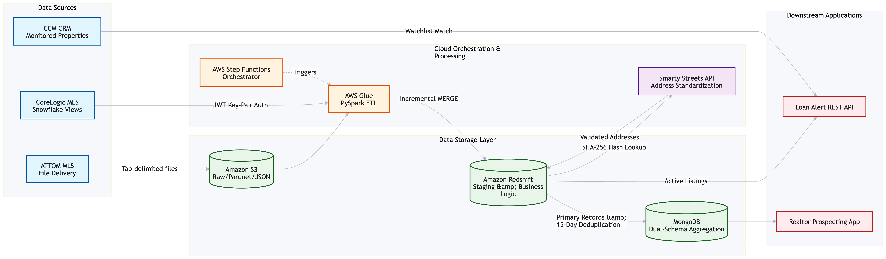
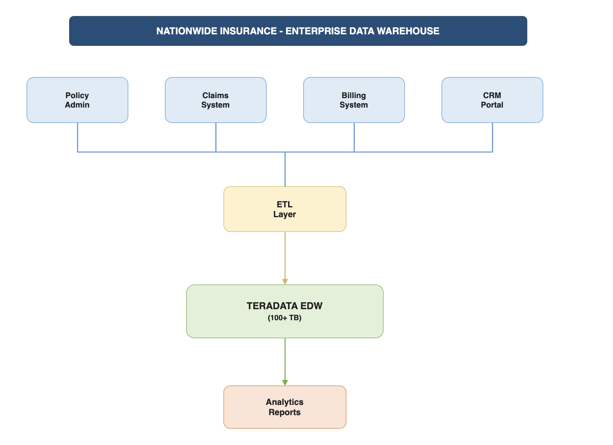

---
hide:
  - toc
  - navigation
---

# Projects

A selection of my enterprise data engineering and architecture projects. Click any card to see the full write-up.

**[CCM Realtor Prospecting Platform](ccm-realtor-prospecting-platform.md)**

Project Lead & Data Architect role designing a multi-source real estate data integration platform for CrossCountry Mortgage. Architected incremental AWS ETL pipelines ingesting millions of MLS records, with a dual-layer MongoDB aggregation engine powering Loan Officer prospecting.

`AWS Step Functions` `PySpark` `MongoDB` `Redshift` `Snowflake` `ETL`

[View Project →](ccm-realtor-prospecting-platform.md){ .md-button }

**[Nationwide Insurance Data Warehouse](nationwide-data-warehouse.md)**

Principal Data Architect role designing enterprise-scale ETL and data warehouse solutions for Fortune 100 insurer. Integrated 48+ source systems into 100+ TB Teradata platform supporting ~85% of business analytics and regulatory compliance.

`Teradata` `ETL` `Data Architecture` `FastLoad` `MultiLoad` `SQL` `Data Modeling`

[View Project →](nationwide-data-warehouse.md){ .md-button }

**[Sample Notebook](sample-notebook.ipynb)**

[YOUR PROJECT DESCRIPTION — demonstrate your data engineering skills: data pipelines, transformations, visualizations, or analytics.]

`Python` `PySpark` `Pandas` `SQL`

[View Project →](sample-notebook.ipynb){ .md-button }

---

##  About My Work

I'm a **Principal Data Architect** with 16+ years of experience building enterprise-grade data platforms that serve as the foundation for AI and analytics.

My projects focus on:
- **Enterprise Data Architecture** - Designing scalable, governed data platforms
- **Cloud Migration & Modernization** - AWS, Azure, GCP, Databricks, Snowflake, Microsoft Fabric
- **AI-Ready Data Engineering** - Building data foundations that power Generative AI and ML applications
- **Distributed Computing** - Apache Spark, PySpark for large-scale data processing

I bridge traditional data engineering fundamentals with emerging AI capabilities while maintaining enterprise requirements: security, governance, scalability, and cost efficiency.