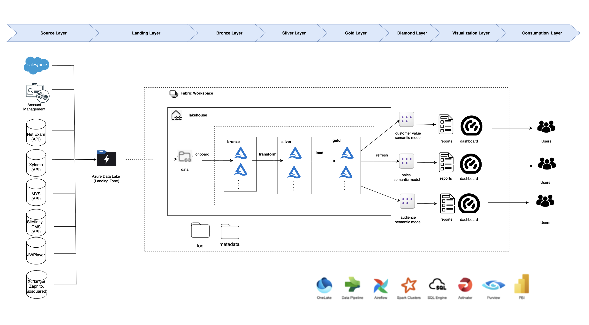
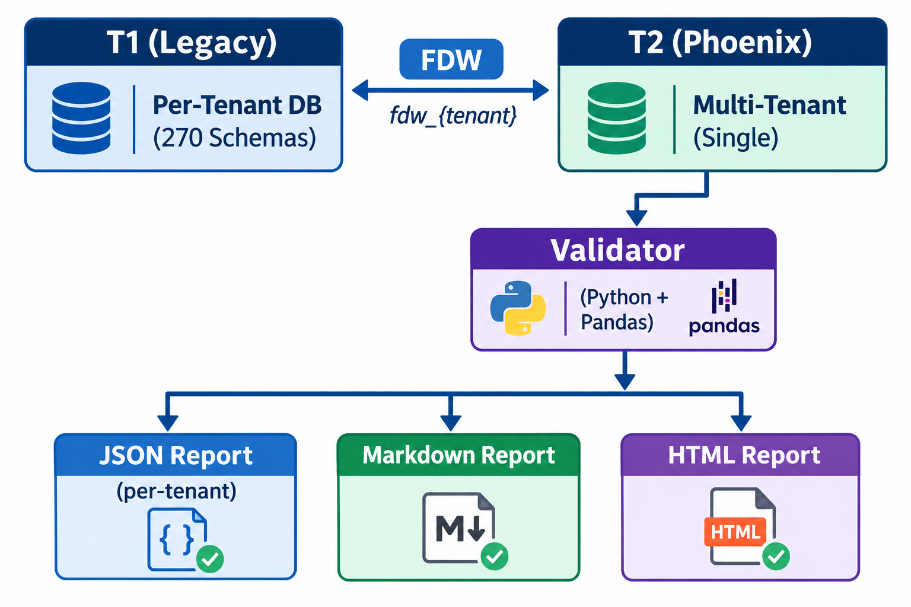

---
hide:
  - toc
  - navigation
---

# Projects

A selection of my enterprise data engineering and architecture projects. Click any card to see the full write-up.

**[CCM Realtor Prospecting Platform](ccm-realtor-prospecting-platform.md)**

Project Lead & Data Architect role designing a multi-source real estate data integration platform for CrossCountry Mortgage. Architected incremental AWS ETL pipelines ingesting millions of MLS records, with a dual-layer MongoDB aggregation engine powering Loan Officer prospecting.

`AWS Step Functions` `PySpark` `MongoDB` `Redshift` `Snowflake` `ETL`

[View Project →](ccm-realtor-prospecting-platform.md){ .md-button }

**[Avixa – Enterprise Data Modernization (Fabric POV)](avixa-fabric-pov.md)**

Data Architect / Lead Engineer role architecting a Microsoft Fabric data lakehouse utilizing a Medallion architecture. Unified fragmented CRM (Salesforce), ERP (Sage Intacct), and marketing (Pardot) data to deliver executive dashboards for Customer Value, Sales Performance, and Audience Engagement, aligning financial data within a ±2% tolerance.

`Microsoft Fabric` `Azure Data Lake` `Power BI` `Apache Spark` `Medallion Architecture` `Salesforce` `Sage Intacct` `Pardot`

[View Project →](avixa-fabric-pov.md){ .md-button }

**[Thrive TRM — Data Migration & Validation Platform](thrive-trm-migration.md)**

Data Quality Engineer & Migration Validation Lead role engineering an automated, field-level data validation framework for migrating 270+ enterprise customers from a legacy per-tenant database architecture to a consolidated multi-tenant SaaS platform. Built a Python + PostgreSQL FDW validation engine performing row-by-row, column-level comparisons across 134+ tables — guaranteeing zero-defect go-lives for 1.2M+ people and 193K+ company records.

`Python` `PostgreSQL` `FDW` `Pandas` `AWS RDS` `Data Validation` `ETL` `Jupyter` `GitHub Actions`

[View Project →](thrive-trm-migration.md){ .md-button }

**[Sample Notebook](sample-notebook.ipynb)**

[YOUR PROJECT DESCRIPTION — demonstrate your data engineering skills: data pipelines, transformations, visualizations, or analytics.]

`Python` `PySpark` `Pandas` `SQL`

[View Project →](sample-notebook.ipynb){ .md-button }

**[Nationwide Insurance Data Warehouse](nationwide-data-warehouse.md)**

Principal Data Architect role designing enterprise-scale ETL and data warehouse solutions for Fortune 100 insurer. Integrated 48+ source systems into 100+ TB Teradata platform supporting ~85% of business analytics and regulatory compliance.

`Teradata` `ETL` `Data Architecture` `FastLoad` `MultiLoad` `SQL` `Data Modeling`

[View Project →](nationwide-data-warehouse.md){ .md-button }

---