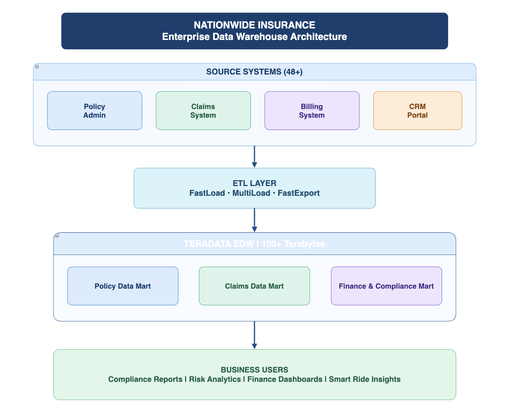
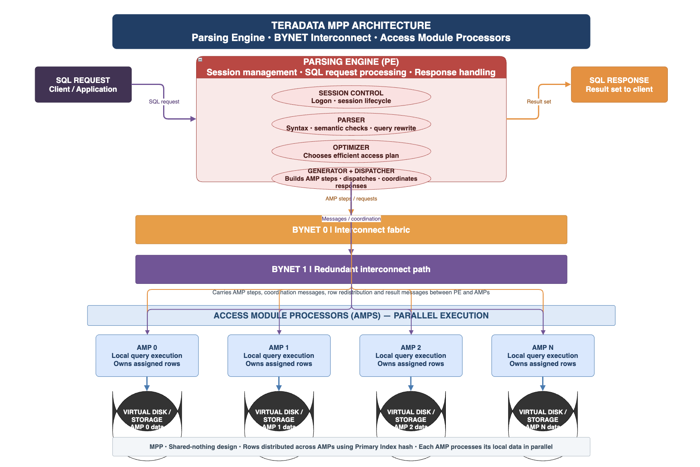

---
hide:
  - toc
  - navigation
---

# Nationwide Insurance Data Warehouse & ETL Platform

## 📊 Project Highlights

-   **48+** Source Systems Integrated
-   **100+ TB** Teradata Enterprise Data Warehouse
-   **~85%** Business Analytics Coverage
-   **6 Years** Enterprise Data Engineering

---

## Overview

Engineered enterprise-scale ETL and data warehouse solutions for Fortune 100 insurer Nationwide, integrating 48+ disparate source systems into a centralized 100+ Terabyte Teradata platform supporting ~85% of business analytics and regulatory reporting.

**Study Area:** Nationwide Insurance Enterprise (US Operations)  
**Duration:** August 2010 – August 2016  
**Role:** Senior System Engineer (IBM India Pvt Ltd)  
**Status:** Completed

---

## ️ Architecture

The enterprise data warehouse integrated multiple source systems through a robust ETL layer into a centralized Teradata platform.

### Key Components

- **Source Systems (48+):** Policy Admin, Claims, Billing, CRM Portal, and 44+ additional systems
- **ETL Layer:** FastLoad, MultiLoad, FastExport for high-performance data movement
- **Teradata EDW (100+ TB):** Centralized data warehouse with multiple data marts
- **Business Users:** Compliance, Risk, Finance, and Smart Ride analytics teams

---

## ⚙️ Teradata MPP Architecture

The platform leveraged Teradata's Massively Parallel Processing (MPP) architecture for high-performance query execution.

### Architecture Components

- **Parsing Engine (PE):** SQL request processing, session management, query optimization
- **BYNET Interconnect:** High-speed communication fabric between PE and AMPs
- **Access Module Processors (AMPs):** Parallel execution engines with local storage
- **Shared-Nothing Design:** Each AMP processes its local data independently

---

## 🛠️ Methods & Tools

### Data Sources

- **Policy Administration Systems:** Legacy mainframes (AS/400) and modern systems (Duck Creek/Guidewire)
- **Claims Management Systems:** Open/closed claims, adjuster notes, payout tracking
- **Billing & Invoicing Systems:** Premium collections, agent commissions, payment gateways
- **CRM & Agent Portals:** Salesforce and custom web portals for quotes and policy binding
- **External Third-Party Data:** MVR (DMV records), credit scores (ISO/Verisk), weather data
- **Finance & HR Systems:** SAP/Oracle for statutory accounting and payroll

### ETL Processing Pipeline

1. **Extract:** Pull data from 48+ source systems using FastLoad for initial loads
2. **Transform:** Apply business rules, data validation, and SCD Type 2 logic
3. **Load:** Use MultiLoad for incremental updates to non-empty tables
4. **Export:** FastExport for downstream system feeds and regulatory reporting
5. **Validate:** Exception handling and error routing for data quality issues

### Tools & Technologies

| Tool | Purpose |
|------|---------|
| **Teradata** | Enterprise data warehouse platform (100+ TB) |
| **FastLoad** | High-speed loading of empty target tables |
| **MultiLoad** | Incremental loads and updates to non-empty tables |
| **FastExport** | Large-volume data extraction for downstream systems |
| **SQL/Stored Procedures** | Complex transformations and business logic |
| **Unix Shell Scripting** | Job automation, SFTP transfers, and orchestration |
| **SCD Type 2** | Historical tracking of policy and customer changes |

---

## 🎯 Key Projects

### Commercial Velocity
Built data pipelines to accelerate the quote-to-bind process for commercial insurance, enabling agents to issue policies in minutes instead of days. Integrated underwriting rules and pricing models into the data warehouse.

### Smart Ride & TTS (Telematics)
Developed ETL workflows for Nationwide's usage-based insurance program. Processed high-volume telematics data (driving behavior, mileage, hard braking events) to calculate risk scores and customer discounts.

### Compliance & Regulatory Reporting
Engineered data marts for Finance and Risk teams to produce accurate statutory reports required by NAIC (National Association of Insurance Commissioners) and state insurance regulators.

---

##  Key Results & Impact

-   **Performance:** Optimized nightly batch processing to meet 4-hour SLA window for mission-critical reporting
-   **Scale:** Successfully integrated 48+ source systems into unified 100+ Terabyte data warehouse
-   **Coverage:** Platform supported ~85% of Nationwide's business analytics operations
-   **Quality:** Implemented robust validation framework reducing data errors in compliance reports

### Technical Achievements

- **Reduced batch processing time by 20%** through SQL optimization and proper use of Teradata utilities
- **Implemented SCD Type 2 logic** to track historical changes in policy addresses and risk factors
- **Built exception handling framework** that routed invalid records to error tables instead of failing entire batches
- **Automated job orchestration** using Unix shell scripts with email alerts for failed jobs

---

## 💡 Challenges & Solutions

### Challenge 1: Data Quality from Legacy Systems
**Problem:** Source data from legacy mainframes had missing Policy IDs and inconsistent date formats.  
**Solution:** Implemented robust data validation checks in the staging layer. Invalid records were routed to exception tables for manual review, preventing batch failures.

### Challenge 2: Meeting Strict SLA Windows
**Problem:** Nightly batch jobs needed to complete within 4 hours to deliver data by 8 AM for business users.  
**Solution:** Optimized SQL queries, collected statistics on join columns to avoid product joins, and used MultiLoad for efficient incremental updates.

### Challenge 3: High-Volume Telematics Data
**Problem:** Smart Ride generated massive amounts of driving behavior data daily.  
**Solution:** Designed scalable ETL pipelines using FastLoad for initial loads and implemented data aggregation logic to reduce storage requirements.

---

## 🔗 Links & Resources

- [View Architecture Diagram](../assets/images/nationwide-teradata-arch.png)
- [View Teradata MPP Diagram](../assets/images/teradata-mpp-arch.png)
- [Download Resume](../assets/Balbeer-Singh-CV.pdf){ .md-button }
- [Back to Projects](index.md){ .md-button }