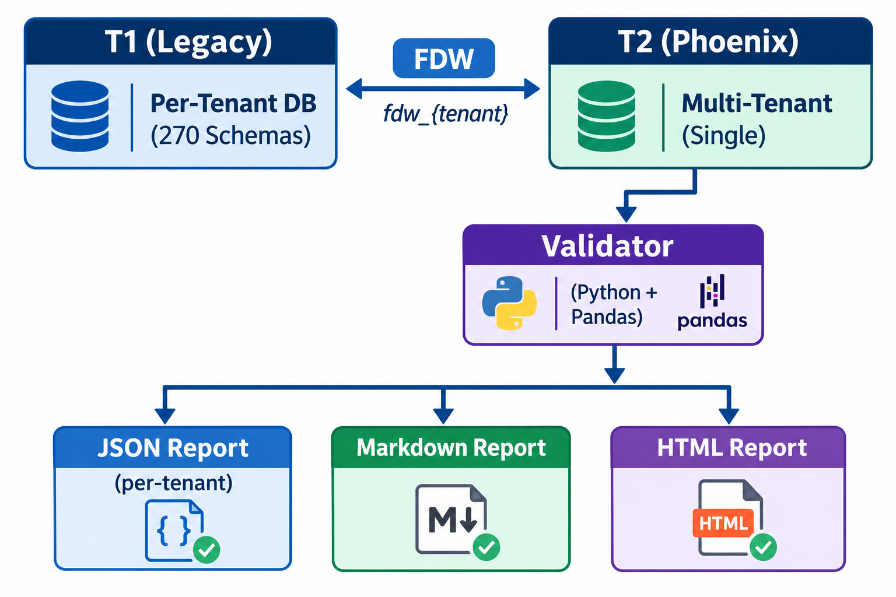

# Thrive TRM — Enterprise SaaS Data Migration & Validation Platform

## Role
**Data Quality Engineer / Migration Validation Lead**

## Client
**Thrive TRM** — Talent Relationship Management platform for executive search firms

## Overview
Thrive TRM is a multi-tenant SaaS platform serving executive search firms, managing 
1.2M+ executives, 193K+ companies, and 99K+ candidate-job relationships. The platform 
underwent a major architectural migration from a legacy per-tenant database schema (T1) 
to a consolidated multi-tenant architecture (T2 / Phoenix), impacting 270+ enterprise 
customers.

## The Challenge
Migrating 270+ customers across 134+ tables with zero data loss was non-negotiable. 
The structural differences between T1 and T2 were significant — schema renames, 
normalized tables, derived fields, and value-map transformations meant that simple 
row-count checks were insufficient. Every field had to be validated at the record 
level before go-live.

## Architecture & Approach
Built an automated validation engine using **Python + PostgreSQL Foreign Data Wrappers (FDW)**:

- **FDW Bridge**: T2 database reads T1 data directly through `fdw_{tenant}` schemas — 
  no data copies, no SSM tunnels, matching production deployment posture.
- **134 Table Query Pairs**: Each pair contains a T1 SQL (reading through FDW) and a 
  T2 SQL (reading native tables), both returning a `match_key` + comparable fields.
- **Smart Match Keys**: Preserved IDs for global tables, transformed natural keys for 
  customer-scoped tables, `import_key` for migrated records — mirroring the migration 
  SQL's own strategy.
- **Value Normalization**: Recursive normalization of JSON, arrays, whitespace, and 
  NULL handling to avoid false-positive mismatches.
- **Incremental Reporting**: JSON + Markdown + HTML reports generated per-tenant, 
  with progress checkpoints for resumable runs.

## Key Technical Highlights
- **Field-level diffing** across 134+ tables including complex domains: candidacies, 
  scorecards, custom fields, GDPR consents, and LinkedIn-enriched data.
- **Value-map mirroring**: Validation queries replicate the exact migration transforms 
  (e.g., 100+ row veteran/disability status maps, seniority level mappings, event 
  type resolution) to ensure apples-to-apples comparison.
- **Tenant isolation verification**: Patch runs fingerprint every other tenant's tables 
  before/after to guarantee no cross-tenant data leakage.
- **Schema drift analysis**: Tooling to compare all 270+ T1 schemas and identify 
  structural divergence before migration.

## Measurable Impact
- **Zero-defect go-lives** for every tenant migration across 270+ customers.
- **1.2M+ people records** and **193K+ company records** validated with field-level 
  precision.
- **99K+ candidacy relationships** verified through complex pipeline state migrations.
- **Incremental reports** enabled parallel migration waves without blocking.

## Technologies
Python, PostgreSQL, AWS RDS, FDW (Foreign Data Wrapper), Pandas, AWS CLI/IAM, 
Jupyter, GitHub Actions, PyTest, Make, Docker

## Artifacts
- `validation_report.ipynb` — Interactive Jupyter validation runner
- `table_specs.py` — 134+ T1/T2 query pair specifications
- `valid.py` — Production migration validator (ported to notebook)
- `schema_drift_analyzer` — Cross-tenant schema comparison tool
- `migration_validator` — Standalone post-migration deep-dive utility